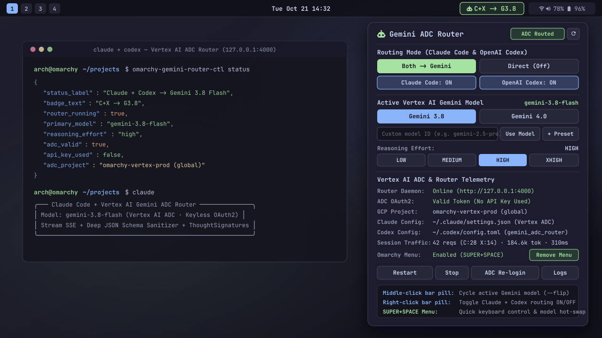

# Omarchy Claude Code & OpenAI Codex $\rightarrow$ Vertex AI Gemini Router (Rust Edition)

> High-performance, zero-dependency-drift **Rust** proxy server (`claude-gemini-router`) and **Omarchy status bar plugin + CLI** (`arch.gemini-router` / `omarchy-gemini-router-ctl`) that routes **Claude Code** (`claude`) and **OpenAI Codex CLI** (`codex`) directly to **Google Cloud Vertex AI** for **Gemini 3.8 Flash** (`gemini-3.8-flash`), **Gemini 4.0 Argon** (`gemini-4-argon`), and **Gemini 3.1 Pro / 3 Flash** using **Application Default Credentials (ADC)** — with **zero API keys**.




---

## Table of Contents

- [Architecture Overview](#architecture-overview)
- [Key Features & Handled Gotchas](#key-features--handled-gotchas)
- [Function Calling, Skills & Tool Search Support](#function-calling-skills--tool-search-support)
- [Model Tier & Reasoning Effort Routing](#model-tier--reasoning-effort-routing)
- [Dynamic Model Configuration Tutorial](#dynamic-model-configuration-tutorial)
- [Supported HTTP Endpoints](#supported-http-endpoints)
- [Omarchy Bar Widget Configuration (`shell.json`)](#omarchy-bar-widget-configuration-shelljson)
- [Installation & Quick Start](#installation--quick-start)
  - [1. Full Installation (Daemon + CLI + Omarchy Bar Plugin)](#1-full-installation-daemon--cli--omarchy-bar-plugin)
  - [2. Install via Omarchy Plugin Manager](#2-install-via-omarchy-plugin-manager)
  - [3. Build from Source with Cargo](#3-build-from-source-with-cargo)
  - [4. One-Command Wrapper Scripts](#4-one-command-wrapper-scripts)
- [Installer & Runtime Scope](#installer--runtime-scope)
- [CLI Reference (`omarchy-gemini-router-ctl`)](#cli-reference-omarchy-gemini-router-ctl)
- [Router Daemon CLI & Environment Variables](#router-daemon-cli--environment-variables)
- [Testing & Verification](#testing--verification)
- [Project Structure](#project-structure)
- [Author & License](#author--license)

---

## Architecture Overview

```text
┌───────────────────────────┐       ┌───────────────────────────┐
│   Claude Code (`claude`)  │       │   OpenAI Codex (`codex`)  │
│  Anthropic Messages API   │       │  Responses & Chat APIs    │
│      POST /v1/messages    │       │  POST /v1/responses       │
└─────────────┬─────────────┘       └─────────────┬─────────────┘
              │                                   │
              └─────────────────┬─────────────────┘
                                ▼
        ┌───────────────────────────────────────────────┐
        │     claude-gemini-router (Rust / Tokio)       │
        │             http://127.0.0.1:4000             │
        ├───────────────────────────────────────────────┤
        │ • Multi-Protocol Translator (Unary + SSE)     │
        │ • Deep JSON Schema Sanitizer ($ref/$defs/...) │
        │ • ThoughtSignature Cache & Replay Store       │
        │ • Hot-Swappable Model & Reasoning Effort      │
        │ • ADC OAuth2 Token Manager (Keyless Only)     │
        └───────────────────────┬───────────────────────┘
                                │ HTTPS (Bearer ADC Token)
                                ▼
        ┌───────────────────────────────────────────────┐
        │           Google Cloud Vertex AI              │
        │   generateContent / streamGenerateContent     │
        │  gemini-3.8-flash · gemini-4-argon · 3.1-pro  │
        └───────────────────────────────────────────────┘
```

---

## Key Features & Handled Gotchas

1. **Pure Rust Native Binaries (Zero Python / Virtualenv Overhead)**:
   - Built with **Rust + Tokio + Reqwest (Rustls)** into two standalone native binaries:
     - `claude-gemini-router`: Async HTTP/1.1 & Server-Sent Events (SSE) translation proxy.
     - `omarchy-gemini-router-ctl`: Security-hardened (`O_NOFOLLOW`, atomic file replacement, UID verification) CLI and Quickshell backend.
   - Eliminates Python `.venv` breakage, `uv`/`pip` package drift, and startup latency.

2. **Strict Keyless ADC Enforcement**:
   - Automatically strips `GEMINI_API_KEY`, `GOOGLE_API_KEY`, `ANTHROPIC_API_KEY`, and `OPENAI_API_KEY` from the process environment on startup.
   - Sets `GOOGLE_API_USE_CLIENT_CERTIFICATE=false` so corporate/Cloudtop Enterprise Certificate Proxy (ECP) environments never mint mTLS/CBA-bound tokens that fail over standard HTTPS endpoints.
   - Refreshes OAuth2 access tokens directly via `~/.config/gcloud/application_default_credentials.json` with automatic fallback to `gcloud auth application-default print-access-token`.

3. **Full Multi-Protocol Translation (Unary & Streaming SSE)**:
   - **Anthropic Messages API (`/v1/messages`, `/v1/messages/count_tokens`)**: Translates system prompts, user/assistant messages, `thinking` blocks, `tool_use`, `tool_result`, `tool_reference`, and streams spec-compliant Anthropic SSE events (`message_start`, `content_block_start`, `content_block_delta`, `content_block_stop`, `message_delta`, `message_stop`).
   - **OpenAI Codex Responses API (`/v1/responses`)**: Native wire protocol support for OpenAI Codex CLI (`wire_api = "responses"`), translating `input_text`, `output_text`, `reasoning` (`encrypted_content` signature preservation), `function_call`, `function_call_output`, and `custom_tool_call` / `custom_tool_call_output` (such as Codex's `apply_patch` freeform grammar tool).
   - **OpenAI Chat Completions API (`/v1/chat/completions`)**: Complete support for `tool_calls`, `role: "tool"`, `reasoning_content`, and `chat.completion.chunk` SSE streaming.

4. **Omarchy Status Bar Integration (`arch.gemini-router`)**:
   - Quickshell bar widget (`GeminiRouter.qml`) showing live routing badge (`ADC Off`, `Claude -> G3.8`, `Codex -> G4`, `C+X -> G3.8`), session token/request telemetry, ADC health, and 1-click toggles for Claude Code, OpenAI Codex, model selection, and thinking effort.
   - Losslessly backs up and restores your pre-existing `~/.claude/settings.json` and `~/.codex/config.toml` when toggling routing on and off.

---

## Function Calling, Skills & Tool Search Support

Vertex AI's `functionDeclarations` and Gemini 3.x / 4.0 `thoughtSignature` validators enforce strict rules that standard Anthropic and OpenAI schemas violate out of the box. `claude-gemini-router` resolves all of these transparently:

| Challenge | How `claude-gemini-router` Solves It |
| :--- | :--- |
| **Complex JSON Schemas in Tools, Skills & MCP** | Recursively resolves local `$ref` pointers against `$defs` / `definitions` (with cycle detection), merges `allOf` branches, unwraps nullable `anyOf`/`oneOf` unions, converts `const` to single-element `enum`, strips unsupported keywords (`$schema`, `additionalProperties`, `exclusiveMinimum`, `default`, `propertyNames`, unsupported `format` values), ensures `OBJECT` schemas have `properties`, and filters `required` arrays to existing property keys. |
| **Gemini `thoughtSignature` Validation on Tool Calls** | Extracts `thoughtSignature` from Vertex AI `functionCall` parts, caches them by `tool_use_id` / `call_id` in `SIGNATURE_STORE`, emits synthetic `thinking` blocks with signatures for stateless clients, and replays `thoughtSignature` directly onto the `functionCall` part in subsequent turns. When a historical tool call lacks a cached signature, injects `"skip_thought_signature_validator"` so Vertex AI never rejects multi-turn conversations with `400 INVALID_ARGUMENT`. |
| **Claude Code `Skill` & `<system-reminder>` Multi-Block User Turns (Argon 4.0 Compatibility)** | When Claude Code invokes a tool or `Skill`, it sends a `user` turn containing `tool_result` along with injected `SKILL.md` prompts (`Base directory for this skill: ...`) and `<system-reminder>` token reminders. While Gemini 3.x tolerates mixed `functionResponse` + `text` parts in a single `user` turn, **Gemini 4.0 Argon (`gemini-4-argon`)** rejects mixed `functionResponse` + `text` turns with `400 INVALID_ARGUMENT: "Requests ending with a model turn are not supported."`. The router folds all accompanying `text` blocks directly into the `functionResponse.response` payload so `functionResponse` turns remain pure and 100% compatible with both `gemini-4-argon` and `gemini-3.8-flash`. |
| **Claude Code `ToolSearch` (`tool_reference` Blocks)** | Converts `{"type": "tool_reference", "tool_name": "..."}` blocks inside `tool_result` content arrays into structured text so deferred MCP/skill tool discovery works seamlessly. |
| **Claude Code Auto Mode Classifier (`safeguard_results`)** | Implements full compatibility with Claude Code's Auto Mode Classifier Billing update (`dangerous-tool-use-2026-09-03`). Emits `safeguard_results` with `{"type": "dangerous_tool_use", "status": {"type": "available", "tool_uses": {"<toolu_id>": {"type": "evaluated", "outcome": "not_flagged"}}}}` in both unary `message` responses and streaming `message_delta` SSE events so Claude Code never falls back to local classifier billing or displays gateway incompatibility warnings. |
| **Undeclared Historical Tools** | Scans conversation history for any `functionCall` / `functionResponse` names not present in the current request's `tools` list and synthesizes stub `functionDeclarations` so Vertex AI never errors on dynamically loaded or unloaded skills/tools. |

---

## Model Tier & Reasoning Effort Routing

| Client Model / Alias | Target Vertex AI Model | Fallback Behavior |
| :--- | :--- | :--- |
| `gemini-3.8`, `gemini-3.8-flash`, `claude-*-sonnet*`, `claude-*-opus*`, `gpt-5-codex`, `gpt-5`, `o3-pro` | `gemini-3.8-flash` (or active `GEMINI_PRIMARY_MODEL`) | Falls back to `GEMINI_FALLBACK_MODEL` or `gemini-3-flash-preview` if unavailable |
| `claude-*-haiku*`, `o4-mini`, `*-mini`, `*-fast` | `gemini-3-flash-preview` (or active `GEMINI_FAST_MODEL`) | Falls back to `GEMINI_FALLBACK_MODEL` if unavailable |
| `gemini-4.0`, `gemini-4.0-pro`, `gemini-4-argon`, `argon` | `gemini-4-argon` | Automatically falls back to `GEMINI_FALLBACK_MODEL` (default `gemini-3.8-flash`) on `404`/`403`/`400` |
| **Any `gemini-*` model ID** (`gemini-2.5-pro`, `gemini-2.5-flash`, `gemini-3.1-pro-preview`, `gemini-5.0-*`, etc.) | Passed through directly to Vertex AI | Falls back to `GEMINI_FALLBACK_MODEL` (or `gemini-3.8-flash`) on `404`/`403`/`400` |
| **Custom Aliases (`GEMINI_MODEL_ALIASES`)** | User-defined mapping (`alias=target`) | Resolved before built-in aliases |

### Reasoning Effort (`thinkingConfig.thinkingLevel`)

- Controlled via model suffix (`-low`, `-medium`, `-high`), request parameters (`reasoning.effort` / `thinking`), runtime `/config` hot-swap, or `GEMINI_REASONING_EFFORT`:
  - `low` $\rightarrow$ `thinkingLevel: "LOW"`
  - `medium` $\rightarrow$ `thinkingLevel: "MEDIUM"`
  - `high` / `xhigh` $\rightarrow$ `thinkingLevel: "HIGH"`

---

## Dynamic Model Configuration Tutorial

Models are **not** hardcoded to only `gemini-3.8-flash` and `gemini-4-argon`. You can dynamically configure any Vertex AI Gemini model ID, customize the bar widget presets, set separate fast/Haiku and fallback models, or define your own model aliases using any of the 5 methods below:

### Method 1: Omarchy Status Bar Popup (`GeminiRouter.qml`)
1. **Left-click** the `󰚩` Gemini Router widget in your Omarchy bar to open the control panel.
2. Under **Active Vertex AI Gemini Model**:
   - Click any **preset button** (dynamically rendered from your `available_models` list).
   - Or type **any Vertex AI Gemini model ID** (for example `gemini-2.5-pro`, `gemini-2.5-flash`, `gemini-3.1-pro-preview`) into the **Custom model ID** input box and click **Use Model** (or press `Enter`).
   - Any custom model you activate is automatically added to your preset buttons and persisted in `~/.config/omarchy/gemini-router/state.json`.
3. **Middle-click** the bar widget at any time to cycle through all models in your `available_models` list (`--flip`).

### Method 2: Plugin Control CLI (`omarchy-gemini-router-ctl`)
`omarchy-gemini-router-ctl` updates the live router daemon (`/config`), `~/.claude/settings.json`, `~/.codex/config.toml`, `~/.config/omarchy/gemini-router/state.json`, and `~/.config/omarchy/gemini-router/router.env` in one atomic operation:

```bash
# 1. Switch active primary model to any Vertex AI Gemini model (or shorthand alias)
omarchy-gemini-router-ctl set-model --model gemini-2.5-pro
omarchy-gemini-router-ctl set-model --model gemini-3.1-pro-preview --effort high

# 2. Cycle to the next model in your available_models list
omarchy-gemini-router-ctl set-model --flip

# 3. Add or remove model presets from the bar widget & --flip rotation
omarchy-gemini-router-ctl set-model --add-model gemini-2.5-pro
omarchy-gemini-router-ctl set-model --add-model gemini-2.5-flash
omarchy-gemini-router-ctl set-model --remove-model gemini-2.5-flash

# 4. Replace the entire preset list at once (comma-separated)
omarchy-gemini-router-ctl set-model --models "gemini-3.8-flash,gemini-4-argon,gemini-2.5-pro,gemini-3.1-pro-preview"

# 5. Configure a custom fast/Haiku tier model or 404/429 fallback model (use "default" to reset)
omarchy-gemini-router-ctl set-model --fast-model gemini-2.5-flash --fallback-model gemini-3.8-flash
```

### Method 3: Persistent Environment File (`~/.config/omarchy/gemini-router/router.env`)
The `claude-gemini-router.service` systemd unit and the `claude-gemini` / `codex-gemini` launchers automatically source `~/.config/omarchy/gemini-router/router.env`:

```ini
GEMINI_PRIMARY_MODEL=gemini-2.5-pro
GEMINI_REASONING_EFFORT=high
GEMINI_AVAILABLE_MODELS=gemini-3.8-flash,gemini-4-argon,gemini-2.5-pro,gemini-3.1-pro-preview

# Optional: override the model used for Claude Haiku / fast background subagents
GEMINI_FAST_MODEL=gemini-2.5-flash

# Optional: override the fallback model when the primary model returns 404/403/400
GEMINI_FALLBACK_MODEL=gemini-3.8-flash

# Optional: define custom model aliases (comma-separated alias=target pairs)
GEMINI_MODEL_ALIASES=my-pro=gemini-2.5-pro,my-fast=gemini-2.5-flash,next=gemini-5.0-ultra

ROUTER_PORT=4000
```

After editing `router.env`, apply it with:
```bash
omarchy-gemini-router-ctl restart-router
```

### Method 4: Live HTTP Hot-Swap API (`POST /config`)
Hot-swap models on the running router daemon without restarting Claude Code or OpenAI Codex by sending a JSON `POST` request to `http://127.0.0.1:4000/config` (which `omarchy-gemini-router-ctl set-model` performs automatically over a local TCP socket):

```json
{
  "primary_model": "gemini-2.5-pro",
  "fast_model": "gemini-2.5-flash",
  "fallback_model": "gemini-3.8-flash",
  "available_models": ["gemini-3.8-flash", "gemini-4-argon", "gemini-2.5-pro"],
  "reasoning_effort": "high",
  "hot_swap": true
}
```

### Method 5: Per-Session Wrapper Flags (`claude-gemini` & `codex-gemini`)
Launch a single terminal session with any custom model without altering global settings:

```bash
claude-gemini --model gemini-2.5-pro
claude-gemini --model=gemini-3.1-pro-preview

codex-gemini --model gemini-2.5-pro --effort high
codex-gemini --model=gemini-3.1-pro-preview --effort=xhigh
```

---

## Supported HTTP Endpoints

| Method | Path | Description |
| :--- | :--- | :--- |
| `GET` | `/health`, `/v1/health` | Returns router status, active model/effort, ADC token & project health, stripped env vars, and live request/token telemetry. |
| `GET`, `POST` | `/config`, `/v1/config` | Inspect or hot-swap `primary_model`, `reasoning_effort`, and `hot_swap` at runtime without restarting the daemon or client. |
| `GET` | `/models`, `/v1/models` | Lists available routed Gemini models (`gemini-3.8-flash`, `gemini-4-argon`, `gemini-3.1-pro-preview`, etc.). |
| `POST` | `/messages`, `/v1/messages` | Anthropic Messages API (Unary JSON & Streaming SSE) for Claude Code. |
| `POST` | `/messages/count_tokens`, `/v1/messages/count_tokens` | Token estimation endpoint required by Claude Code prior to requests. |
| `POST` | `/responses`, `/v1/responses` | OpenAI Responses API (Unary JSON & Streaming SSE) for OpenAI Codex CLI. |
| `POST` | `/chat/completions`, `/v1/chat/completions` | OpenAI Chat Completions API (Unary JSON & Streaming SSE). |

---

## Omarchy Bar Widget Configuration (`shell.json`)

Widget settings can be customized on the `arch.gemini-router` entry in `~/.config/omarchy/shell.json` (matching the schema in `manifest.json`):

```json
{
  "id": "arch.gemini-router",
  "badgeStyle": "compact",
  "notificationsEnabled": true,
  "autoOpenOnAuthError": false,
  "pollIntervalSeconds": 5
}
```

| Setting | Default | Description |
| :--- | :--- | :--- |
| `badgeStyle` | `"compact"` | Status bar label format: `"compact"` (`C+X -> G3.8`), `"full"` (`Claude+Codex -> gemini-3.8-flash`), or `"icon"` (icon only). |
| `notificationsEnabled` | `true` | Send desktop notifications when switching routing targets, models, or when ADC re-authentication is required. |
| `autoOpenOnAuthError` | `false` | Automatically open the Gemini Router popup panel when ADC credentials expire while routing is enabled. |
| `pollIntervalSeconds` | `5` | Background status polling interval in seconds (`2`–`60`; paused while the screen is locked). |

---

## Installation & Quick Start

### Prerequisites

1. **Rust Toolchain** (`cargo`, `rustc` 1.75+)
2. **Google Cloud SDK (`gcloud`)** authenticated with Application Default Credentials:
   ```bash
   gcloud auth application-default login
   gcloud config set project YOUR_GCP_PROJECT_ID
   ```

### 1. Full Installation (Daemon + CLI + Omarchy Bar Plugin)

```bash
git clone https://github.com/unrealandychan/omarchy-claude-codex-router.git
cd omarchy-claude-codex-router

./install.sh
```

`./install.sh` performs the following:
- Compiles the optimized release binaries (`claude-gemini-router` and `omarchy-gemini-router-ctl`).
- Installs `claude-gemini-router`, `omarchy-gemini-router-ctl`, `claude-gemini`, and `codex-gemini` into `~/.local/bin/`.
- Installs and starts the systemd user service `claude-gemini-router.service` on `http://127.0.0.1:4000`.
- Links the Omarchy bar widget into `~/.config/omarchy/plugins/arch.gemini-router` and registers it in `~/.config/omarchy/shell.json`.

### 2. Install via Omarchy Plugin Manager

```bash
omarchy plugin add https://github.com/unrealandychan/omarchy-claude-codex-router.git --enable
```

If you install the QML bar widget via `omarchy plugin add` before building the Rust daemon, open the `󰚩` bar widget popup and click **Install Rust Daemon & CLI (`install.sh`)** to build and start the local router service in a terminal window.

### 3. Build from Source with Cargo

```bash
cargo build --release --locked
# Binaries are produced at:
#   ./target/release/claude-gemini-router
#   ./target/release/omarchy-gemini-router-ctl
```

### 4. One-Command Wrapper Scripts

Launch Claude Code or OpenAI Codex routed through the local Rust ADC proxy without modifying your global config files:

```bash
# Launch Claude Code on Gemini 3.8 Flash (default) or Gemini 4.0 Argon
./bin/claude-gemini --3.8
./bin/claude-gemini --4.0

# Launch OpenAI Codex on Gemini 3.8 Flash (default) or Gemini 4.0 Argon
./bin/codex-gemini --3.8
./bin/codex-gemini --4.0 --effort=high
```

---

## Installer & Runtime Scope

`install.sh` and `uninstall.sh` run entirely as your user, without privilege escalation or download tools; nothing is downloaded except the exact-pinned Rust crates in `Cargo.lock` that `cargo build --locked` fetches from crates.io, verified against `Cargo.lock` checksums.

`install.sh` touches only these user-scoped paths:

| Path | Change |
| :--- | :--- |
| `./target/` | `cargo build --locked --release` output inside the checkout |
| `~/.local/bin/claude-gemini-router` | Installed router daemon binary; a different existing file is moved to `*.bak.<timestamp>`, never overwritten |
| `~/.local/bin/omarchy-gemini-router-ctl` | Installed plugin CLI binary (same backup rule) |
| `~/.local/bin/claude-gemini`, `~/.local/bin/codex-gemini` | Installed wrapper scripts (same backup rule) |
| `~/.config/omarchy/gemini-router/router.env` | Default router environment file (created only if absent, `0600`) |
| `~/.config/systemd/user/claude-gemini-router.service` | User systemd service (`127.0.0.1:4000`, `WorkingDirectory=%h`); backed up if modified |
| `${XDG_STATE_HOME:-~/.local/state}/omarchy/arch.gemini-router/install-receipt.json` | SHA-256 of installed files and source checkout path (directory `0700`, file `0600`) |
| `~/.config/omarchy/plugins/arch.gemini-router` | Symlink to the checkout; an existing different entry is moved to `*.bak.<timestamp>` |
| `~/.config/omarchy/shell.json` | Backed up, then `{"id": "arch.gemini-router"}` is added to the bar's right section if absent, using an `O_NOFOLLOW` + `dir_fd` atomic replace that refuses symlinks and files owned by another user |

`uninstall.sh` verifies SHA-256 provenance against `install-receipt.json` before removing any binary, service unit, or symlink, disables routing to losslessly restore `~/.claude/settings.json` and `~/.codex/config.toml` from their backups, and removes the `SUPER+SPACE` menu block if enabled.

---

## CLI Reference (`omarchy-gemini-router-ctl`)

All `omarchy-gemini-router-ctl` commands output structured JSON (pass `--notify` to also send a desktop notification via `omarchy-notification-send`):

```bash
# View full router, ADC, Claude Code, Codex, and menu status + telemetry
omarchy-gemini-router-ctl status

# Enable routing for Claude Code (~/.claude/settings.json), Codex (~/.codex/config.toml), or both
omarchy-gemini-router-ctl enable --target both --notify
omarchy-gemini-router-ctl enable --target claude --model gemini-4-argon
omarchy-gemini-router-ctl enable --target codex --model gemini-3.8-flash --effort high

# Toggle routing state on/off
omarchy-gemini-router-ctl toggle --target both --notify
omarchy-gemini-router-ctl toggle --target claude
omarchy-gemini-router-ctl toggle --target codex

# Hot-swap active Gemini model & reasoning effort across daemon + client configs
omarchy-gemini-router-ctl set-model --model gemini-4-argon --effort high --notify
omarchy-gemini-router-ctl set-model --model gemini-3.8-flash --effort medium
omarchy-gemini-router-ctl set-model --flip --notify

# Disable routing and losslessly restore original ~/.claude/settings.json and ~/.codex/config.toml
omarchy-gemini-router-ctl disable --target both --notify

# Opt-in / opt-out of the SUPER+SPACE Omarchy Menu entry (~/.config/omarchy/extensions/menu.sh)
omarchy-gemini-router-ctl menu --enable
omarchy-gemini-router-ctl menu --disable
omarchy-gemini-router-ctl menu --toggle
omarchy-gemini-router-ctl menu --status

# Manage the background router daemon
omarchy-gemini-router-ctl start-router
omarchy-gemini-router-ctl restart-router
omarchy-gemini-router-ctl stop-router
omarchy-gemini-router-ctl logs --lines 50

# Launch interactive gcloud ADC login in your terminal emulator
omarchy-gemini-router-ctl adc-login
```

---

## Router Daemon CLI & Environment Variables

```bash
claude-gemini-router [--host 127.0.0.1] [--port 4000] [--project GCP_PROJECT_ID] [--location global]
```

| Environment Variable | Default | Description |
| :--- | :--- | :--- |
| `ROUTER_HOST` | `127.0.0.1` | Bind address for the HTTP server |
| `ROUTER_PORT` | `4000` | Listen port for the HTTP server |
| `GOOGLE_CLOUD_PROJECT` | Auto-detected from ADC / `gcloud` | Google Cloud Project ID used for Vertex AI requests |
| `GOOGLE_CLOUD_LOCATION` | `global` | Vertex AI region (`global`, `us-central1`, etc.) |
| `GEMINI_PRIMARY_MODEL` | `gemini-3.8-flash` | Default primary Vertex AI Gemini model (any `gemini-*` model ID) |
| `GEMINI_DEFAULT_MODEL` | `gemini-3.1-pro-preview` | Fallback default model when `GEMINI_PRIMARY_MODEL` is not set |
| `GEMINI_FAST_MODEL` | `gemini-3-flash-preview` | Target model for Claude Haiku / fast background subagent requests |
| `GEMINI_FALLBACK_MODEL` | `gemini-3.8-flash` | Target fallback model when the primary model returns `404`/`403`/`400` |
| `GEMINI_AVAILABLE_MODELS` | `gemini-3.8-flash,gemini-4-argon` | Comma-separated list of preset models exposed in `/v1/models`, `--flip`, and the bar widget |
| `GEMINI_MODEL_ALIASES` | *(empty)* | Comma-separated `alias=target` pairs (e.g. `next=gemini-5.0-ultra,fast=gemini-2.5-flash`) |
| `GEMINI_REASONING_EFFORT` | `medium` | Default thinking effort (`low`, `medium`, `high`, `xhigh`) |
| `GEMINI_HOT_SWAP_ALL` | `0` | When `1` or enabled via `/config`, overrides explicit client model tiers with `GEMINI_PRIMARY_MODEL` |

---

## Testing & Verification

Run both the Rust integration test suite and the Omarchy CLI/plugin security & functional test suite:

```bash
# 1. Run Rust unit & integration tests (ADC stripping, schema sanitizer, multi-turn tool/skill calls, SSE streaming)
cargo test

# 2. Run the 67-assertion Omarchy CTL & security test suite
./tests/test-ctl.sh
```

---

## Project Structure

```text
omarchy-claude-codex-router/
├── manifest.json                      # Omarchy bar-widget plugin manifest (arch.gemini-router v1.1.0)
├── preview.png                        # Omarchy Marketplace preview screenshot
├── install.sh                         # Security-hardened user installer (receipts, backups, atomic writes)
├── uninstall.sh                       # Provenance-verified user uninstaller
├── plugin/
│   └── GeminiRouter.qml               # Quickshell status bar widget & control popup
├── Cargo.toml                         # Rust package manifest & dependencies
├── Cargo.lock                         # Locked dependency graph
├── src/
│   ├── lib.rs                         # Library exports
│   ├── adc_auth.rs                    # Keyless Google Cloud ADC credential & token manager
│   ├── translator.rs                  # Anthropic / OpenAI Chat / Codex Responses <-> Vertex AI Gemini translator
│   ├── server.rs                      # Async Tokio HTTP/1.1 + SSE router server & metrics
│   └── bin/
│       ├── claude-gemini-router.rs    # Router daemon CLI entrypoint
│       └── omarchy-gemini-router-ctl.rs # Omarchy plugin backend CLI & config manager
├── tests/
│   ├── router_tests.rs                # Integration tests for schemas, tool/skill calling, streaming, and server endpoints
│   └── test-ctl.sh                    # 67-assertion functional & security test suite for omarchy-gemini-router-ctl
├── bin/
│   ├── claude-gemini                  # Keyless launcher wrapper for Claude Code
│   └── codex-gemini                   # Keyless launcher wrapper for OpenAI Codex
├── skills/
│   └── gemini-adc-router/SKILL.md     # Agent skill definition
└── commands/
    └── gemini-router.md               # Slash command definition
```

---

## Author & License

- **Author**: Eddie Chan (<eddie.chan@connect.ust.hk>)
- **Repository**: [https://github.com/unrealandychan/omarchy-claude-codex-router](https://github.com/unrealandychan/omarchy-claude-codex-router)
- **License**: [MIT](LICENSE)
